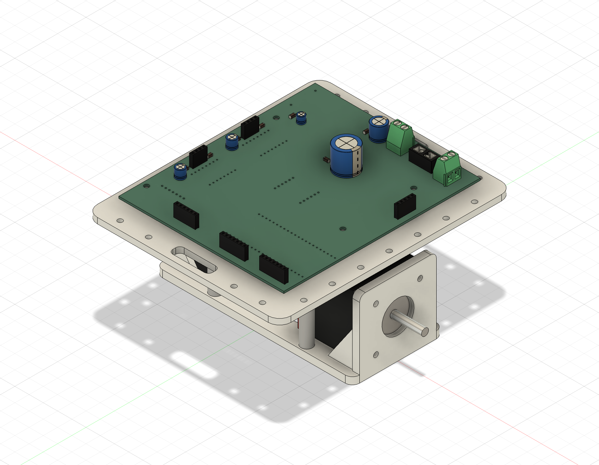

# Self-Balancing Robot

Robot autoequilibrado en desarrollo, con PCB propia, diseño mecánico en Fusion 360 y herramientas de control y visualización. Proyecto personal de **Alfredo Waugh Tocornal**.

Este repositorio reúne el diseño electrónico, los modelos CAD y los ensayos de firmware y software disponibles al 15 de octubre de 2026. La integración completa y la demostración de equilibrio autónomo están pendientes de validación.

*Vista del diseño CAD. No corresponde a una fotografía de un prototipo físico terminado.*

## Qué contiene

| Área | Trabajo disponible | Archivos |
|---|---|---|
| Electrónica | Esquema y PCB de dos capas en KiCad 10; ESP32-S3, TMC2209 y BNO085 en el esquema | [Proyecto KiCad](hardware/kicad), [vista de la PCB](docs/pcb-front.svg) |
| Mecánica | Base para motores NEMA 17 y encoders AS5600, plataforma para PCB, columnas y separadores | [Base de motores](mechanical/motor-base), [plataforma PCB](mechanical/pcb-deck) |
| Lectura de orientación | Firmware BNO085 y visualizador 3D de cuaterniones | [Firmware IMU](firmware/bno085), [visualizador Python](software/imu_visualizer.py) |
| Control experimental | Ensayo de control proporcional de un motor con medición de roll y ajuste desde una interfaz Qt | [Firmware de ensayo](firmware/nemamasimu), [interfaz](software/roll_controller.py) |
| Motores y encoders | Prueba independiente de dos TMC2209 y dos AS5600 con ESP32-S3 | [Prueba de banco](firmware/prueba_nema17_as5600) |
| Fabricación | Exportaciones históricas Gerber y taladros, STEP, STL y archivos Fusion 360 | [Gerbers](hardware/manufacturing), [CAD](mechanical) |

## Estado de desarrollo

- Diseño de circuito, ruteo de PCB, símbolos y huellas personalizados disponibles.
- Archivos CAD editables y exportaciones para inspeccionar la integración mecánica.
- Código de ensayos de lectura de IMU, control proporcional y movimiento de motores.
- Pendiente: unificar firmware, comprobar su correspondencia con el pinout de la PCB y validar el conjunto físico.
- Pendiente: registrar pruebas, resultados y un video del robot manteniendo el equilibrio.

Los programas son ensayos separados. `nemamasimu` describe un motor con A4988; la PCB utiliza dos TMC2209. No se ha establecido que esos ensayos puedan cargarse directamente en la PCB sin adaptar sus pines y configuración. El ensayo de dos motores tiene su propio cableado, documentado en su carpeta.

## Abrir el diseño

En **KiCad 10**, abre `hardware/kicad/Circuito Self-Balancing Robot.kicad_pro`. Se incluyen las huellas locales y dos bibliotecas de símbolos del proyecto. El esquema conserva sus símbolos embebidos. La edición de símbolos `PCM_Espressif` y los modelos 3D estándar pueden requerir instalar las bibliotecas correspondientes en tu equipo.

En **Autodesk Fusion 360**, importa los `.f3d` de `mechanical/`. Los `.step` permiten consultar la geometría en otros programas; los `.stl` corresponden a piezas individuales. Las instrucciones y dimensiones se encuentran en el `LEEME.md` de cada conjunto.

Los archivos de fabricación se conservan como exportaciones de trabajo del 5 de octubre. El PCB editable fue guardado después; no se asume que las exportaciones correspondan exactamente a su estado final. Consulta [las notas de fabricación](hardware/manufacturing/README.md).

## Usar el software

Consulta [software/README.md](software/README.md) para instalar dependencias, seleccionar el puerto serie y elegir la pareja de firmware e interfaz adecuada. El código de los ensayos se conserva sin modificar su lógica de control.

## Documentación

- [Arquitectura y protocolos](docs/architecture.md)
- [Estado y verificaciones](docs/status.md)
- [Procedencia de los archivos](docs/provenance.md)
- [Inventario con hashes SHA-256](docs/source-manifest.csv)
- [Atribuciones y componentes externos](THIRD_PARTY.md)

## Próximos hitos

1. Consolidar la asignación de pines y el firmware para la PCB.
2. Validar alimentación, sensores, drivers y mecánica del conjunto.
3. Integrar y ajustar el control de equilibrio con ambos motores.
4. Añadir registros de pruebas, fotografías del montaje y un video demostrativo.

## Autoría

Alfredo Waugh Tocornal. [LinkedIn](https://www.linkedin.com/in/alfredo-waugh-tocornal-26b0122b6).

Este repositorio no establece una licencia general de redistribución. Las bibliotecas y los diseños de terceros mantienen sus condiciones originales; consulta `THIRD_PARTY.md`.
