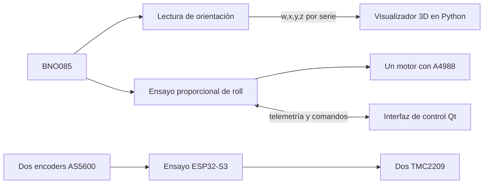

# Arquitectura y protocolos

El proyecto combina un diseño de PCB con ESP32-S3, módulos de potencia y sensado, un chasis de dos niveles y ensayos de software desarrollados por separado.

## Ensayos disponibles

Este diagrama representa las parejas de programas existentes; no describe una integración física completa ya validada.

## Formatos serie

Todos los programas utilizan 115200 baudios.

- Lectura IMU: `w,x,y,z`, un cuaternión por línea. Compatible con `imu_visualizer.py`.
- Ensayo de roll: `DATA,w,x,y,z,roll,zero,error,speed,calibrating,Kp`. Compatible con `roll_controller.py`.
- Comandos de la interfaz de roll: `START`, `STOP`, `RECAL`, `KP,<valor>`, terminados en salto de línea.
- Prueba de dos motores: comandos `1`, `2` y `s`, con salida de diagnóstico de texto. No comparte el protocolo de las dos interfaces Qt.

## Parámetros del ensayo de roll

El código original tiene ganancia proporcional inicial de 120 pasos/s por grado, saturación de 10.000 pasos/s, zona muerta de 0,20 grados y calibración inicial de tres segundos. Estos valores documentan el código; no acreditan estabilidad ni validación del robot completo.

## Mecánica

Los modelos Fusion 360 incluyen una base para dos NEMA 17 con espacio para AS5600 y una plataforma elevada para la PCB. Los archivos `LEEME.md` originales documentan dimensiones, holguras y verificaciones geométricas. Su alcance no incluye ensayos físicos de resistencia o de equilibrio.
